<div align="center">

<h1>kirisute</h1>

<strong>Cut Game Boy Advance, DS, DSi and 3DS ROMs and PSP ISOs down to their real size, and name them after their headers.</strong>

English | [日本語](README.ja.md) | [简体中文](README.zh-Hans.md) | [繁體中文 (香港)](README.zh-HK.md)

[](https://github.com/gufranco/kirisute/actions/workflows/ci.yml)
[](https://github.com/gufranco/kirisute/releases/latest)
[](LICENSE)

<p align="center">
  <a href="#quick-start"><strong>Quick start</strong></a> |
  <a href="#what-is-kept">What is kept</a> |
  <a href="#rename">Rename</a> |
  <a href="#compress">Compress</a> |
  <a href="#development">Development</a>
</p>

</div>

A cartridge dump is as large as the chip it came from, and a disc image can carry padding past its last sector. `kirisute` is 切り捨て, Japanese for cutting off the remainder: it reads each file's header and drops what comes after the data, so a 64 MiB dump of a 24 MiB game takes 24 MiB on a flash cart's card.

---

<p align="center">
  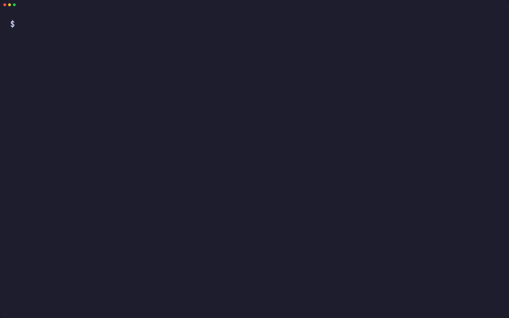
</p>

```console
$ kirisute --backup download-play.nds advance.gba cartridge.3ds umd.iso notes.nds

Files:  5 ROMs, 304.1 MiB
Plan:   cut each ROM to the size its header declares
        keep each original as <rom>.bak

Trimmed download-play.nds from 32.0 MiB to 8.0 MiB, keeping its download-play
certificate.
Trimmed advance.gba from 16.0 MiB to 6.0 MiB.
Trimmed cartridge.3ds from 128.0 MiB to 42.0 MiB.
Trimmed umd.iso from 128.0 MiB to 100.0 MiB.
kirisute: warning: notes.nds has a bad logo checksum and is not a DS ROM, so it
stays as it is.
Trimmed 4 of 5 ROMs and saved 148.0 MiB.
```

<a id="quick-start"></a>

## Quick start

### Prerequisites

| Tool | Why | Install |
|:-----|:----|:--------|
| [`gum`](https://github.com/charmbracelet/gum) | The terminal interface: menus, prompts, tables and colours | `brew install gum`. Installed automatically by the Homebrew formula |
| `awk`, `od`, `head`, `tail`, `tr`, `wc` | Read the header and copy the ROM's data | Part of every Linux and macOS system |
| `mktemp`, `mv`, `stat`, `chmod`, `rm` | Write the trimmed copy beside the ROM and swap it in | Part of every Linux and macOS system |
| `cmp` | Check that a compressed copy decompresses to the original | Part of every Linux and macOS system |
| [maxcso](https://github.com/unknownbrackets/maxcso) | Write CSO and ZSO copies for `compress` | `brew install gufranco/tap/maxcso`; the Homebrew formula pulls it in |

### Install

```bash
brew install gufranco/tap/kirisute
```

Or from source:

```bash
git clone https://github.com/gufranco/kirisute.git
cd kirisute
make install
```

`make install` copies the tool, its man page and its bash, zsh and fish completions under `~/.local`, and puts `kirisute` in `~/.local/bin`; set `PREFIX` to change that. The Homebrew formula installs the same files.

### Verify

```console
$ kirisute doctor
gum                ok       /opt/homebrew/bin/gum
awk                ok       /opt/homebrew/opt/gawk/libexec/gnubin/awk, gnu 5.4.1
od                 ok       /usr/bin/od, bsd
head               ok       /usr/bin/head, bsd
tail               ok       /usr/bin/tail, bsd
tr                 ok       /usr/bin/tr, bsd
wc                 ok       /usr/bin/wc, bsd
mktemp             ok       /usr/bin/mktemp, bsd
mv                 ok       /bin/mv, bsd
stat               ok       /usr/bin/stat, bsd
chmod              ok       /bin/chmod, bsd
rm                 ok       /bin/rm, bsd
cmp                ok       /opt/homebrew/bin/cmp, gnu 3.12
maxcso             ok       /opt/homebrew/bin/maxcso, 1.13.0
```

## Usage

| Command | Purpose |
|:--------|:--------|
| `kirisute [options] <rom>...` | Trim each ROM file, and the ROM files of each folder given |
| `kirisute rename [options] <rom>...` | Rename each ROM after the title and code in its header |
| `kirisute compress [options] <iso>...` | Write a CSO or ZSO copy of each PSP disc image for ARK-4 and ARK-5 |
| `kirisute` with no arguments | Ask for a ROM file or folder, offering the current folder, when run in a terminal |
| `kirisute doctor` | List the tools kirisute needs, with the flavor and version of each |
| `kirisute version`, `kirisute help` | Print the version or the full usage page |

| Option | Effect |
|:-------|:-------|
| `--dry-run` | List what would be trimmed or renamed and change nothing |
| `--info` | Print each ROM's header: title, code, the fields its system adds, trimmed size and padding |
| `--verify`, `--no-verify` | Trim only a ROM whose padding holds nothing but `00` or `FF` bytes |
| `--backup`, `--no-backup` | Keep each original as `<rom>.bak`, or the first free `<rom>.bak.N`; on by default |
| `--recursive` | Look for ROM files in every subfolder too |
| `--json` | Print the result as one JSON object, for scripts |
| `--theme <name>` | Colours of the terminal interface |

`KIRISUTE_VERIFY=yes` makes `--verify` the default and `KIRISUTE_BACKUP=no` turns the backup off; an option on the command line wins. kirisute follows the shared command-line contract of its family, described in [FAMILY.md](FAMILY.md).

```bash
kirisute --dry-run *.nds *.3ds           # see what trimming would save
kirisute --backup --verify game.nds      # keep the original, refuse if the padding holds data
kirisute --recursive ~/roms              # trim a whole library
kirisute rename --dry-run *.gba          # see the name each ROM would take
kirisute compress game.iso               # write game.cso for ARK-4 and ARK-5
```

### Themes

On a terminal with `gum` installed, kirisute draws its menus, prompts, tables and messages with gum; in a pipe or a script the output stays plain text. `--theme`, else `KIRISUTE_THEME`, else `KODOUGU_THEME` picks the colours, the last one shared by every kodougu tool: `kodougu` (default), `catppuccin-mocha`, `catppuccin-latte`, `dracula`, `nord`, `gruvbox`, `tokyo-night` or `mono`. `KODOUGU_ACCENT=#RRGGBB` replaces only the accent, and `NO_COLOR` turns colour off.

```bash
export KODOUGU_THEME=catppuccin-mocha
```

<a id="what-is-kept"></a>

## What is kept

| File | Extension | Trimmed to |
|:-----|:----------|:-----------|
| DS | `.nds` | The ROM size in the header, at offset `0x80` |
| DS with download play | `.nds` | That size plus the 136-byte RSA certificate that follows it |
| DSi-enhanced or DSi-only | `.nds` | The DSi area size in the header, at offset `0x210` |
| Game Boy Advance | `.gba` | Its last byte that is not padding, rounded up to 4 bytes, when that saves at least 512 bytes |
| 3DS cartridge image | `.3ds`, `.cci` | The end of its last partition, in the media unit its header sets |
| 3DS executable | `.cxi` | The size its NCCH header declares |
| PSP disc image | `.iso` | The volume its ISO 9660 descriptor declares, only when everything past it is `00` or `FF` |

- Each file is checked before it is touched. A DS or Game Boy Advance ROM needs a correct logo and header checksum; a 3DS image needs the NCSD magic, a media ID and partitions in order, and a console NAND image is refused; a PSP image needs the system name `PSP GAME`, `UMD VIDEO` or `UMD AUDIO`, or a `PSP_GAME` folder. A file that fails, that is too small for a header, or whose header declares more than the file holds, stays as it is with a warning, and the run ends with status 1.
- Without `--verify`, the bytes past the real size are dropped whatever they hold. With it, a ROM with anything but `00` or `FF` there stays as it is, and the warning names the first such byte.
- A PSP image always gets that check. Dumpers size an image by the disc's last sector rather than by its file system, and a game can read sectors outside its files, so kirisute never cuts data it cannot prove is padding. It never removes anything inside the volume either: update data, padding files and videos all stay. A development DVD-R image holding `USER_L0.IMG` and `USER_L1.IMG` is refused until its two layers are joined.
- A trimmed file no longer matches the checksum of an untrimmed dump in databases such as Redump or No-Intro, so each original is kept as `<rom>.bak` unless `--no-backup` says otherwise.
- Each trimmed ROM is written to a temporary file beside it, given the original's permissions and renamed over it, so an interrupted run never leaves half a file.
- A folder gives only the files with the extensions above directly inside it, in any case; `--recursive` walks up to 32 folders deep. A file given by name with another extension is read as a DS ROM. Symbolic links, hidden files such as `._game.nds`, and hidden folders are left alone.

<a id="rename"></a>

## Rename

`kirisute rename` names each ROM after its header, so a folder of dumps reads like a catalog:

```console
$ kirisute rename --dry-run download-play.nds advance.gba cartridge.3ds umd.iso

Files:  4 ROMs, 156.0 MiB
Plan:   rename each ROM after the title and code in its header
        dry run: list each new name and change nothing

Would rename download-play.nds to KIRISUTE (KSTE).nds.
Would rename advance.gba to KIRISUTE GBA (AKSE).gba.
Would rename cartridge.3ds to CTR-P-AKSE.3ds.
Would rename umd.iso to Kirisute Test (ULUS99999).iso.
Dry run: 4 ROMs would be renamed. Nothing was changed.
```

- The name is `<title> (<code>)`, or the code alone when the header has no title, as a 3DS image does. A PSP image takes its title and disc ID from `PSP_GAME/PARAM.SFO`.
- The extension is kept in lowercase. Slashes and colons in a title become hyphens, and control characters are dropped.
- A name another file already has is never taken: that ROM stays as it is with a warning. A change of letter case alone works on a Mac's disk too.
- `rename` takes `--dry-run`, `--recursive` and `--json`.

<a id="compress"></a>

## Compress

`kirisute compress` writes a compressed copy of each PSP disc image with [maxcso](https://github.com/unknownbrackets/maxcso), in a format the ARK-4 and ARK-5 custom firmware read, and keeps the original:

```console
$ kirisute compress --dry-run umd.iso

Files:  1 ROM, 100.0 MiB
Plan:   compress each PSP disc image to CSO v2 in 8 KiB blocks
        use LZ4 only where it is smaller than deflate
        keep each original and check that each copy decompresses to it
        dry run: list each copy and change nothing

Would compress umd.iso to umd.cso as CSO v2.
Dry run: 1 ROM would be compressed. Nothing was changed.
```

| Option | Effect | Default |
|:-------|:-------|:--------|
| `--format cso` | CSO v1: deflate only, the format older firmware reads, slowest of the three to load | |
| `--format cso2` | CSO v2: deflate or LZ4 for each block, small and quicker to read | yes |
| `--format zso` | ZSO: LZ4 only, the fastest to read, a larger file | |
| `--block N` | Block size: 2048, 4096, 8192 or 16384 bytes. Larger blocks compress a little better | 8192 |
| `--lz4-cost N` | For CSO v2, use LZ4 for a block when it costs at most N% more space, trading space for read speed; 0 uses LZ4 only where it is smaller | 0 |
| `--best` | Add one more slow trial, Zopfli for CSO v1 and v2 or brute-force LZ4 for ZSO: a slightly smaller copy, much slower to make | off |

`KIRISUTE_FORMAT`, `KIRISUTE_BLOCK`, `KIRISUTE_LZ4_COST` and `KIRISUTE_BEST` set the same defaults.

- A copy is named `game.cso` or `game.zso`, the extensions ARK lists. A CSO v2 file is a `.cso` too; a `.cso2` name never shows on the console.
- A copy is kept only after it decompresses back to the original byte for byte, which needs free space as large as the image while the check runs. An existing copy is never overwritten.
- DAX and JSO are not written. maxcso's DAX blocks lack the zlib header ARK expects, and no open-source JSO writer exists. ZSO covers JSO's fast reads.
- The defaults write the same bytes as `maxcso --format=cso2 --block=8192 --use-zlib --use-7zdeflate --use-lz4 --use-lz4brute`, whose copies boot on ARK-4 and ARK-5. A higher `--lz4-cost`, `--best`, CSO v1 and ZSO are formats the ARK reader decodes, but they have not been tried on a console yet.
- Trim an image first if you want its padding gone; compression already stores runs of zeros in almost no space.

## Portability

Everything is POSIX `sh` with ShellCheck `-o all` at zero findings. The suites run on macOS under `/bin/sh`, `dash`, the system's bash 3.2 and zsh, and Homebrew's current bash and zsh, and on Ubuntu under `dash`, `bash`, `bash --posix` and `zsh`. CI repeats them on the family's six toolsets: Linux with uutils, GNU or BusyBox tools, and macOS with the tools it ships, Homebrew's newer builds of them, or Homebrew's uutils tools. `kirisute doctor` names the flavor and version of each tool, so a bug report says which tools ran.

<a id="screens"></a>

## Screens

<details>
<summary>Every screen, recorded from a real run with <code>make screens</code></summary>
<br>

<table>
<tr>
<td width="50%" valign="top">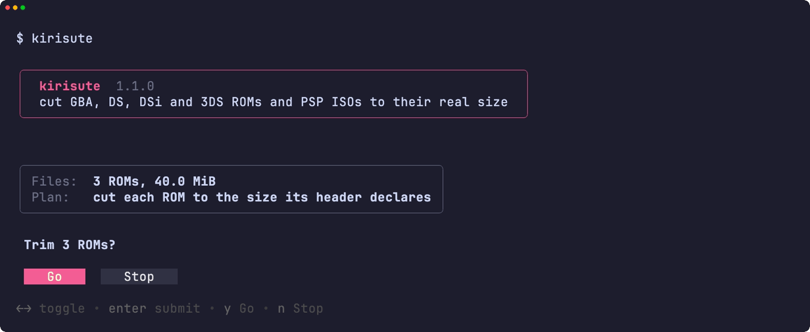<br><sub>The summary, then the confirmation</sub></td>
<td width="50%" valign="top">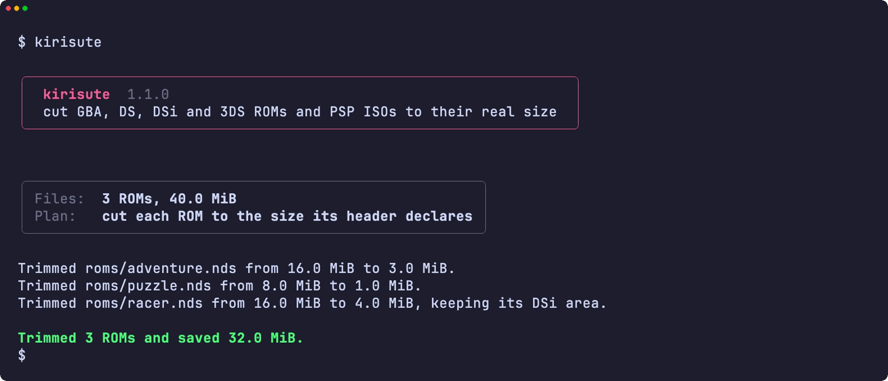<br><sub>The result</sub></td>
</tr>
<tr>
<td width="50%" valign="top">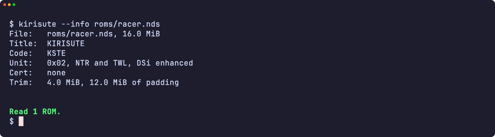<br><sub>--info prints a ROM's header</sub></td>
<td width="50%" valign="top">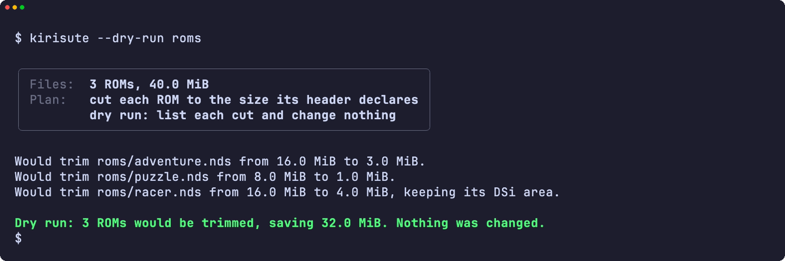<br><sub>A dry run, changing nothing</sub></td>
</tr>
<tr>
<td width="50%" valign="top">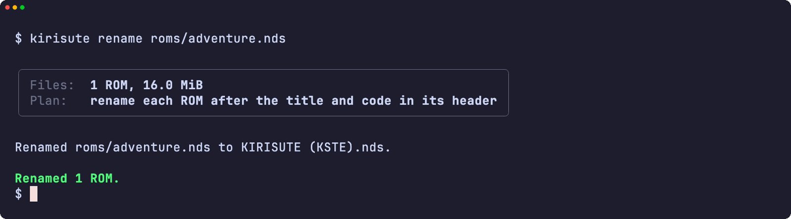<br><sub>A ROM renamed after its header</sub></td>
<td width="50%" valign="top">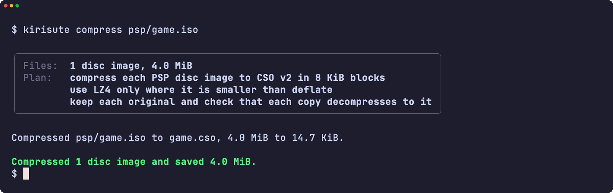<br><sub>A PSP disc image compressed</sub></td>
</tr>
<tr>
<td width="50%" valign="top">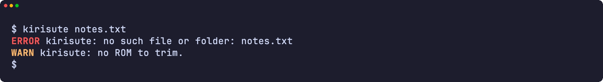<br><sub>An error</sub></td>
<td width="50%" valign="top">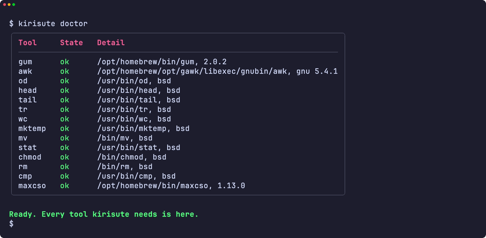<br><sub>doctor checks every tool it needs</sub></td>
</tr>
<tr>
<td width="50%" valign="top">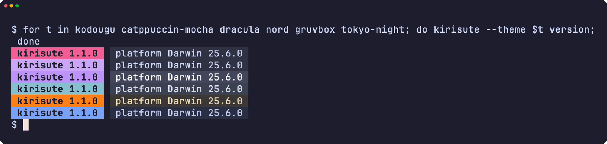<br><sub>The version badge in six themes</sub></td>
<td width="50%" valign="top">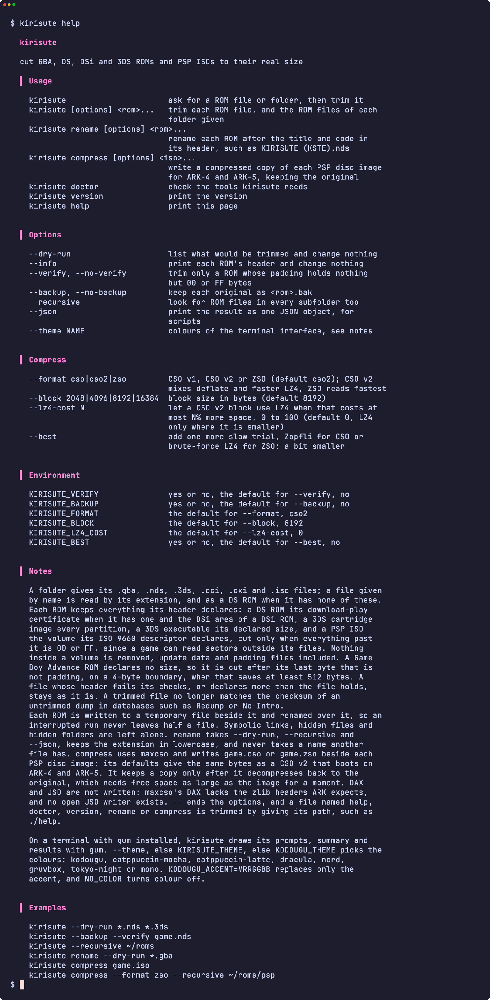<br><sub>The help page</sub></td>
</tr>
</table>

</details>

<a id="development"></a>

## Development

| Command | Description |
|:--------|:------------|
| `make fmt` | Formats every script with shfmt |
| `make lint` | shfmt, ShellCheck on every script, test and completion, the name check, mandoc on the man page, and yamllint and actionlint on the workflows |
| `make test` | The `bats` tests under the system `sh` |
| `make test-all` | The same tests under every shell, both builds of bash and zsh included on macOS |
| `make test-linux` | The same tests in an Ubuntu container |
| `make coverage` | bashcov line coverage on this Mac and in the Ubuntu container, merged, with the 100% gate CI enforces |
| `make screens` | Record the README screens from the real tool with VHS, on macOS |

The tests trim real files. One builder per system writes them with valid headers and checksums: [`test/rom.bash`](test/rom.bash) for DS, [`test/gba.bash`](test/gba.bash), [`test/ctr.bash`](test/ctr.bash) for 3DS and [`test/psp.bash`](test/psp.bash). They use a stand-in for the logo bitmap, so no Nintendo or Sony data is in the repository. Only failures are injected, through small wrappers on `PATH`. Once CI passes on a push to `main`, semantic-release runs: a `feat` or `fix` commit publishes a release, updates `KIRISUTE_VERSION` in [`lib/core.sh`](lib/core.sh) and the CHANGELOG, and bumps the Homebrew formula.

## License

[MIT](LICENSE).
