<div align="center">

<h1>kirisute</h1>

<strong>把 Game Boy Advance、DS、DSi 和 3DS 的 ROM 以及 PSP 的 ISO 剪裁至真正的大小，並按標頭資料命名。</strong>

[English](README.md) | [日本語](README.ja.md) | [简体中文](README.zh-Hans.md) | 繁體中文 (香港)

[](https://github.com/gufranco/kirisute/actions/workflows/ci.yml)
[](https://github.com/gufranco/kirisute/releases/latest)
[](LICENSE)

<p align="center">
  <a href="#quick-start"><strong>快速開始</strong></a> |
  <a href="#what-is-kept">保留甚麼</a> |
  <a href="#rename">重新命名</a> |
  <a href="#compress">壓縮</a> |
  <a href="#development">開發</a>
</p>

</div>

卡帶的轉儲與原來的晶片一樣大，光碟映像亦可能在最後一個磁區之後帶有填充資料。`kirisute` 是日語的「切り捨て」，意思是捨去餘下的部分：它讀取每個檔案的標頭，刪去資料之後的內容，所以一個 24 MiB 遊戲的 64 MiB 轉儲在燒錄卡的記憶卡上只佔 24 MiB。

---

<p align="center">
  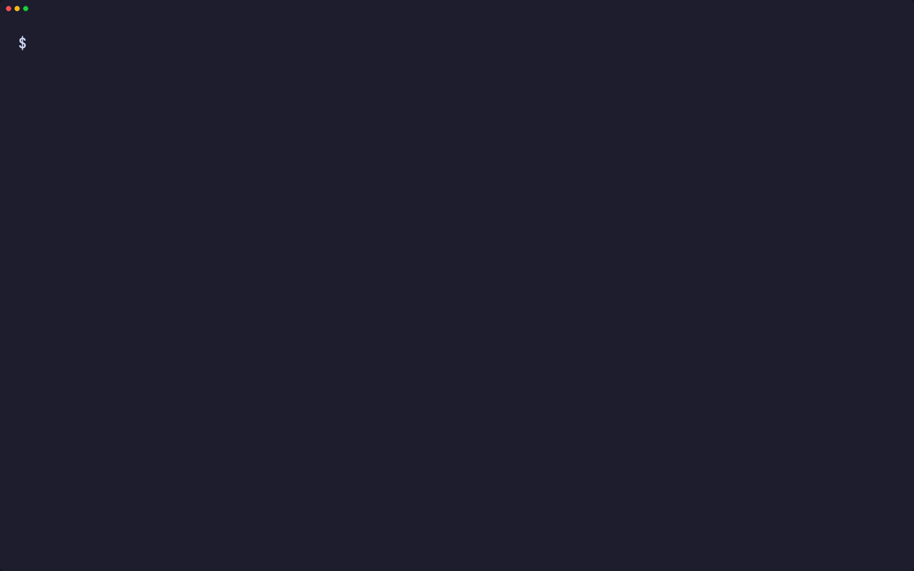
</p>

```console
$ kirisute --backup download-play.nds advance.gba cartridge.3ds umd.iso notes.nds

Files:  5 ROMs, 304.1 MiB
Plan:   cut each ROM to the size its header declares
        keep each original as <rom>.bak

Trimmed download-play.nds from 32.0 MiB to 8.0 MiB, keeping its download-play
certificate.
Trimmed advance.gba from 16.0 MiB to 6.0 MiB.
Trimmed cartridge.3ds from 128.0 MiB to 42.0 MiB.
Trimmed umd.iso from 128.0 MiB to 100.0 MiB.
kirisute: warning: notes.nds has a bad logo checksum and is not a DS ROM, so it
stays as it is.
Trimmed 4 of 5 ROMs and saved 148.0 MiB.
```

<a id="quick-start"></a>

## 快速開始

### 先決條件

| 工具 | 用途 | 安裝 |
|:-----|:-----|:-----|
| [`gum`](https://github.com/charmbracelet/gum) | 終端介面：選單、輸入、表格及配色 | `brew install gum`。Homebrew formula 會自動安裝 |
| `awk`、`od`、`head`、`tail`、`tr`、`wc` | 讀取標頭並複製 ROM 的資料 | Linux 和 macOS 已預載 |
| `mktemp`、`mv`、`stat`、`chmod`、`rm` | 在 ROM 旁寫入剪裁後的副本並替換 | Linux 和 macOS 已預載 |
| `cmp` | 檢查壓縮副本能否解壓回原檔 | Linux 和 macOS 已預載 |
| [maxcso](https://github.com/unknownbrackets/maxcso) | 為 `compress` 寫出 CSO 和 ZSO 副本 | `brew install gufranco/tap/maxcso`；Homebrew formula 會一併安裝 |

### 安裝

```bash
brew install gufranco/tap/kirisute
```

亦可從原始碼安裝：

```bash
git clone https://github.com/gufranco/kirisute.git
cd kirisute
make install
```

`make install` 會把工具、man 說明頁，以及 bash、zsh 和 fish 的自動完成複製到 `~/.local`，並把 `kirisute` 放進 `~/.local/bin`；設定 `PREFIX` 可更改位置。Homebrew formula 會安裝同樣的檔案。

### 驗證

```console
$ kirisute doctor
gum                ok       /opt/homebrew/bin/gum
awk                ok       /opt/homebrew/opt/gawk/libexec/gnubin/awk, gnu 5.4.1
od                 ok       /usr/bin/od, bsd
head               ok       /usr/bin/head, bsd
tail               ok       /usr/bin/tail, bsd
tr                 ok       /usr/bin/tr, bsd
wc                 ok       /usr/bin/wc, bsd
mktemp             ok       /usr/bin/mktemp, bsd
mv                 ok       /bin/mv, bsd
stat               ok       /usr/bin/stat, bsd
chmod              ok       /bin/chmod, bsd
rm                 ok       /bin/rm, bsd
cmp                ok       /opt/homebrew/bin/cmp, gnu 3.12
maxcso             ok       /opt/homebrew/bin/maxcso, 1.13.0
```

## 用法

| 指令 | 用途 |
|:-----|:-----|
| `kirisute [options] <rom>...` | 剪裁每個 ROM 檔案，以及所給資料夾內的 ROM 檔案 |
| `kirisute rename [options] <rom>...` | 按標頭中的標題和代碼重新命名每個 ROM |
| `kirisute compress [options] <iso>...` | 為 ARK-4 和 ARK-5 寫出每個 PSP 光碟映像的 CSO 或 ZSO 副本 |
| 不帶參數的 `kirisute` | 在終端機中執行時詢問 ROM 檔案或資料夾，預設為目前的資料夾 |
| `kirisute doctor` | 列出所需的工具及各自的種類與版本 |
| `kirisute version`、`kirisute help` | 顯示版本或完整的用法說明 |

| 選項 | 作用 |
|:-----|:-----|
| `--dry-run` | 列出會剪裁或重新命名的內容，不作任何改動 |
| `--info` | 顯示每個 ROM 的標頭：標題、代碼、各系統獨有的欄位、剪裁後大小和填充資料 |
| `--verify`、`--no-verify` | 只剪裁填充資料全是 `00` 或 `FF` 位元組的 ROM |
| `--backup`、`--no-backup` | 把每個原檔保留為 `<rom>.bak` |
| `--recursive` | 亦在所有子資料夾中尋找 ROM 檔案 |
| `--json` | 把結果輸出為一個 JSON 物件，供腳本使用 |
| `--theme <name>` | 終端介面的配色 |

`KIRISUTE_VERIFY=yes` 和 `KIRISUTE_BACKUP=yes` 會令 `--verify` 和 `--backup` 成為預設；指令行上的選項優先。kirisute 遵從家族共用的指令行約定，內容見 [FAMILY.md](FAMILY.md)。

```bash
kirisute --dry-run *.nds *.3ds           # 看看剪裁能節省多少
kirisute --backup --verify game.nds      # 保留原檔，填充資料中有內容便拒絕
kirisute --recursive ~/roms              # 剪裁整個遊戲庫
kirisute rename --dry-run *.gba          # 看看每個 ROM 會取甚麼名稱
kirisute compress game.iso               # 為 ARK-4 和 ARK-5 寫出 game.cso
```

### 主題

在裝有 `gum` 的終端機上，kirisute 用 gum 繪製選單、輸入、表格及訊息；在管道或指令碼中，輸出仍是純文字。配色依次由 `--theme`、`KIRISUTE_THEME`、`KODOUGU_THEME` 決定，最後一個由所有 kodougu 工具共用：`kodougu`（預設）、`catppuccin-mocha`、`catppuccin-latte`、`dracula`、`nord`、`gruvbox`、`tokyo-night` 或 `mono`。`KODOUGU_ACCENT=#RRGGBB` 只取代強調色，`NO_COLOR` 關閉顏色。

```bash
export KODOUGU_THEME=catppuccin-mocha
```

<a id="what-is-kept"></a>

## 保留甚麼

| 檔案 | 副檔名 | 剪裁至 |
|:-----|:-------|:-------|
| DS | `.nds` | 標頭偏移 `0x80` 處的 ROM 大小 |
| 附下載遊玩的 DS | `.nds` | 該大小加上其後 136 位元組的 RSA 證書 |
| DSi 增強或 DSi 專用 | `.nds` | 標頭偏移 `0x210` 處的 DSi 區域大小 |
| Game Boy Advance | `.gba` | 最後一個非填充位元組，向上取整至 4 位元組，且只在能節省至少 512 位元組時剪裁 |
| 3DS 卡帶映像 | `.3ds`、`.cci` | 最後一個分區的結尾，按標頭設定的媒體單位計算 |
| 3DS 執行檔 | `.cxi` | NCCH 標頭聲明的大小 |
| PSP 光碟映像 | `.iso` | ISO 9660 卷描述符聲明的卷，且只在其後全是 `00` 或 `FF` 時剪裁 |

- 每個檔案在處理前都會檢查。DS 和 Game Boy Advance 的 ROM 需要正確的標誌和標頭校驗和；3DS 映像需要 NCSD 魔數、媒體 ID 和次序正確的分區，主機 NAND 映像會被拒絕；PSP 映像需要系統名稱 `PSP GAME`、`UMD VIDEO` 或 `UMD AUDIO`，或者 `PSP_GAME` 資料夾。檢查不通過、小得容不下標頭、或標頭聲明的大小超過檔案本身的檔案，會保持原狀並發出警告，執行以狀態 1 結束。
- 沒有 `--verify` 時，真正大小之後的位元組不論內容都會被刪去。加上之後，那裏只要有 `00` 和 `FF` 以外的位元組，該 ROM 便保持原狀，警告會指出第一個這樣的位元組。
- PSP 映像一定會做這項檢查。轉儲工具按光碟的最後一個磁區而非檔案系統決定映像大小，遊戲亦能讀取檔案以外的磁區，所以 kirisute 絕不剪去無法證明是填充資料的內容。卷內的內容亦絕不刪除：更新資料、填充檔案和影片都會保留。含有 `USER_L0.IMG` 和 `USER_L1.IMG` 的開發用 DVD-R 映像會被拒絕，直至把兩層接合起來。
- 剪裁後的檔案不再與 Redump 或 No-Intro 等資料庫中未剪裁轉儲的校驗和相符。`--backup` 可保留原檔。
- 每個剪裁後的 ROM 先寫入旁邊的暫存檔，賦予原檔的權限，再改名覆蓋原檔，所以中斷的執行不會留下寫了一半的檔案。
- 資料夾只提供直接放在其中、副檔名屬於上表的檔案，不分大小寫；`--recursive` 最多深入 32 層資料夾。按名稱給出的其他副檔名檔案會當作 DS ROM 讀取。符號連結、`._game.nds` 這類隱藏檔案和隱藏資料夾都不會處理。

<a id="rename"></a>

## 重新命名

`kirisute rename` 按標頭資料為每個 ROM 命名，令一整個資料夾的轉儲讀起來像一份目錄：

```console
$ kirisute rename --dry-run download-play.nds advance.gba cartridge.3ds umd.iso

Files:  4 ROMs, 156.0 MiB
Plan:   rename each ROM after the title and code in its header
        dry run: list each new name and change nothing

Would rename download-play.nds to KIRISUTE (KSTE).nds.
Would rename advance.gba to KIRISUTE GBA (AKSE).gba.
Would rename cartridge.3ds to CTR-P-AKSE.3ds.
Would rename umd.iso to Kirisute Test (ULUS99999).iso.
Dry run: 4 ROMs would be renamed. Nothing was changed.
```

- 名稱是 `<標題> (<代碼>)`；如 3DS 映像般標頭沒有標題時，只用代碼。PSP 映像的標題和光碟 ID 取自 `PSP_GAME/PARAM.SFO`。
- 副檔名保持小寫。標題中的斜線和冒號會變成連字號，控制字元會被刪去。
- 絕不會佔用其他檔案已有的名稱：那個 ROM 會保持原狀並發出警告。只改變大小寫的重新命名在 Mac 的磁碟上亦能完成。
- `rename` 接受 `--dry-run`、`--recursive` 和 `--json`。

<a id="compress"></a>

## 壓縮

`kirisute compress` 以 [maxcso](https://github.com/unknownbrackets/maxcso) 為每個 PSP 光碟映像寫出壓縮副本，格式可由自製韌體 ARK-4 和 ARK-5 讀取，並保留原檔：

```console
$ kirisute compress --dry-run umd.iso

Files:  1 ROM, 100.0 MiB
Plan:   compress each PSP disc image to CSO v2 in 8 KiB blocks
        use LZ4 only where it is smaller than deflate
        keep each original and check that each copy decompresses to it
        dry run: list each copy and change nothing

Would compress umd.iso to umd.cso as CSO v2.
Dry run: 1 ROM would be compressed. Nothing was changed.
```

| 選項 | 作用 | 預設 |
|:-----|:-----|:-----|
| `--format cso` | CSO v1：只用 deflate，較舊的韌體亦能讀取，三者中載入最慢 | |
| `--format cso2` | CSO v2：每個區塊選用 deflate 或 LZ4，體積細，讀取亦較快 | 是 |
| `--format zso` | ZSO：只用 LZ4，讀取最快，檔案較大 | |
| `--block N` | 區塊大小：2048、4096、8192 或 16384 位元組。區塊越大壓縮得稍好 | 8192 |
| `--lz4-cost N` | 對 CSO v2，當 LZ4 最多多佔 N% 空間時便用 LZ4，以空間換讀取速度；0 即只在 LZ4 較細時使用 | 0 |
| `--best` | 多加一次慢速嘗試：CSO v1 和 v2 用 Zopfli，ZSO 用暴力 LZ4。副本略細，但製作慢得多 | 關 |

`KIRISUTE_FORMAT`、`KIRISUTE_BLOCK`、`KIRISUTE_LZ4_COST` 和 `KIRISUTE_BEST` 可設定同樣的預設值。

- 副本命名為 `game.cso` 或 `game.zso`，即 ARK 會列出的副檔名。CSO v2 檔案亦是 `.cso`；`.cso2` 的名稱不會在主機上顯示。
- 副本只有在逐位元組解壓回原檔後才會保留，檢查期間需要與映像同樣大小的可用空間。已有的副本絕不會被覆蓋。
- 不寫出 DAX 和 JSO。maxcso 的 DAX 區塊缺少 ARK 預期的 zlib 標頭，而開源的 JSO 寫入工具並不存在。ZSO 能提供 JSO 的快速讀取。
- 預設設定寫出的位元組與 `maxcso --format=cso2 --block=8192 --use-zlib --use-7zdeflate --use-lz4 --use-lz4brute` 完全相同，其副本能在 ARK-4 和 ARK-5 上開機。較大的 `--lz4-cost`、`--best`、CSO v1 和 ZSO 是 ARK 讀取器能解碼的格式，但仍未在主機上試過。
- 想去掉填充資料便先剪裁；壓縮本身亦幾乎不為連續的零佔空間。

## 可攜性

全部以 POSIX `sh` 編寫，ShellCheck `-o all` 零警告。測試在 macOS 上於 `/bin/sh`、`dash`、系統內置的 bash 3.2 和 zsh、Homebrew 最新的 bash 和 zsh 下執行，在 Ubuntu 上於 `dash`、`bash`、`bash --posix` 和 `zsh` 下執行。CI 會在家族的六種工具組合上重複這些測試：Linux 的 uutils、GNU 或 BusyBox 工具，以及 macOS 內置的工具、Homebrew 的較新版本或 Homebrew 的 uutils 工具。`kirisute doctor` 會列出每個工具的種類與版本，讓錯誤報告說明執行的是哪些工具。

<a id="screens"></a>

## 畫面

<details>
<summary>全部畫面，均由 <code>make screens</code> 錄自真實執行</summary>
<br>

<table>
<tr>
<td width="50%" valign="top">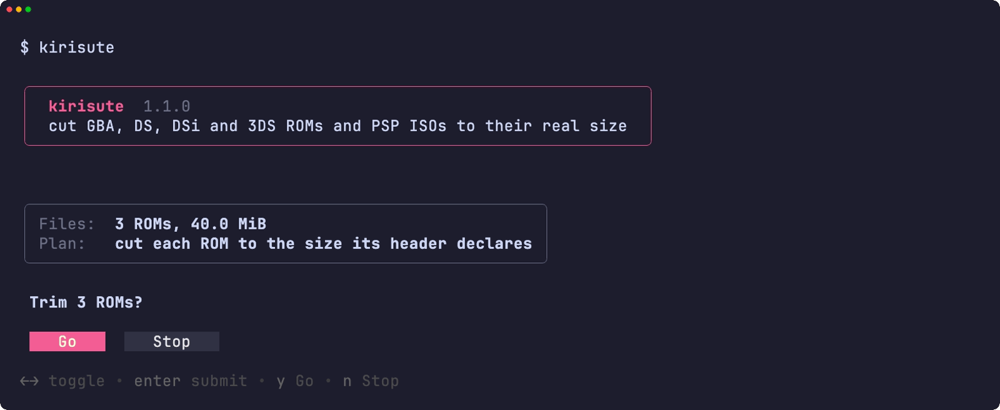<br><sub>概要與確認</sub></td>
<td width="50%" valign="top">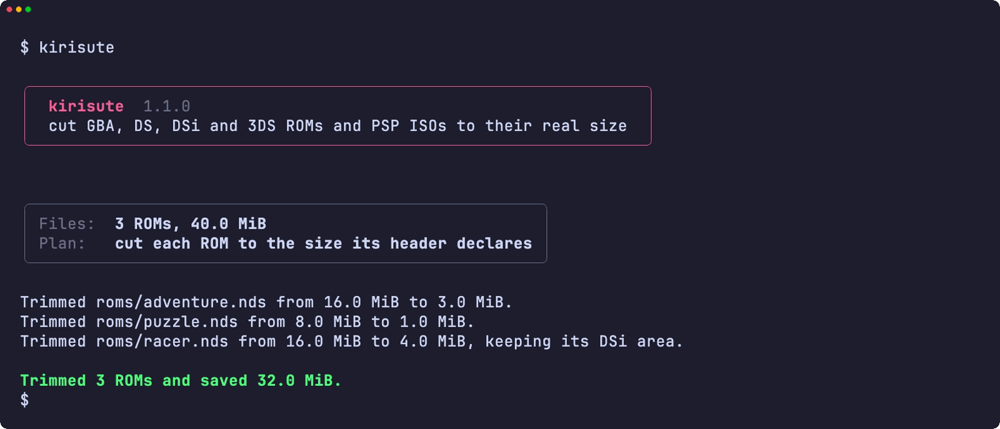<br><sub>結果</sub></td>
</tr>
<tr>
<td width="50%" valign="top">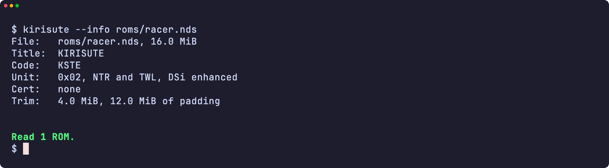<br><sub>--info 顯示 ROM 的檔頭</sub></td>
<td width="50%" valign="top">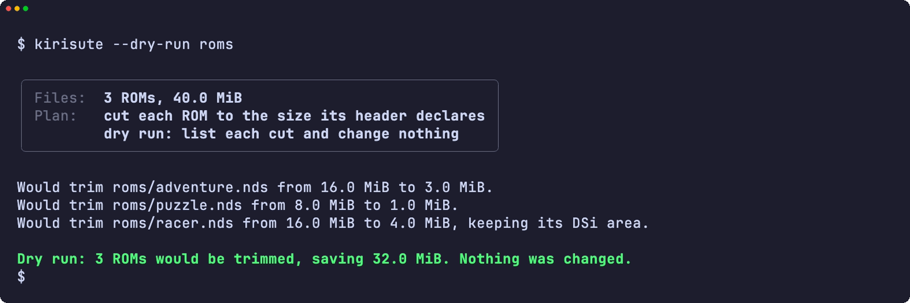<br><sub>不作任何更改的試運行</sub></td>
</tr>
<tr>
<td width="50%" valign="top">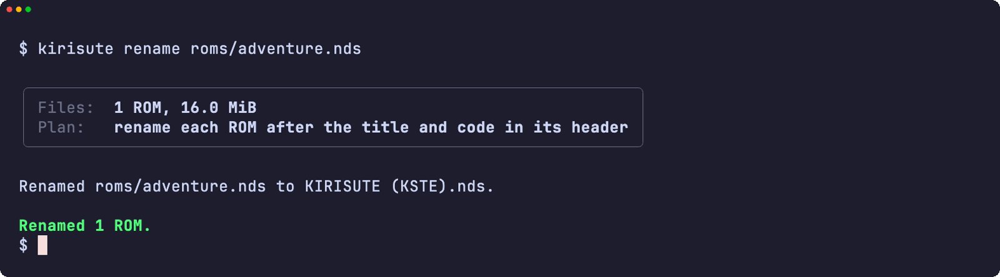<br><sub>按檔頭重新命名的 ROM</sub></td>
<td width="50%" valign="top">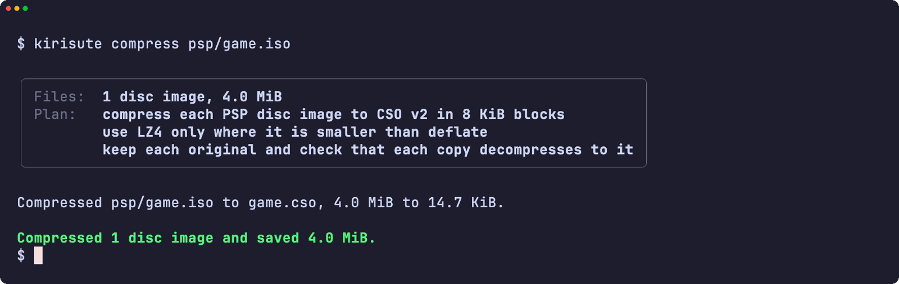<br><sub>壓縮後的 PSP 光碟映像</sub></td>
</tr>
<tr>
<td width="50%" valign="top">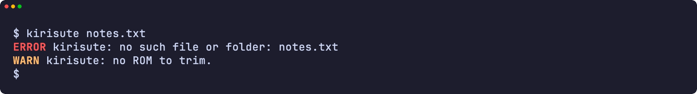<br><sub>錯誤</sub></td>
<td width="50%" valign="top">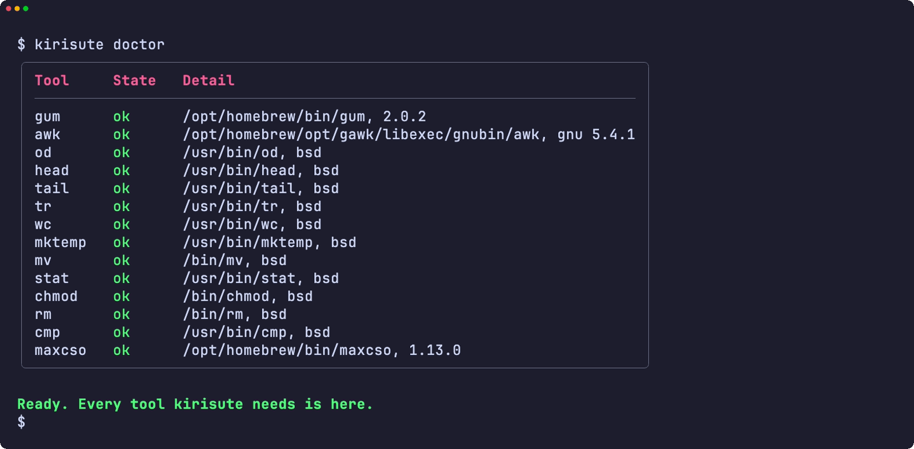<br><sub>doctor 檢查所需的每個工具</sub></td>
</tr>
<tr>
<td width="50%" valign="top">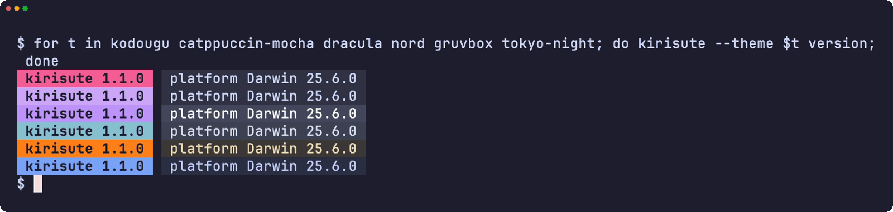<br><sub>六種主題下的版本標記</sub></td>
<td width="50%" valign="top">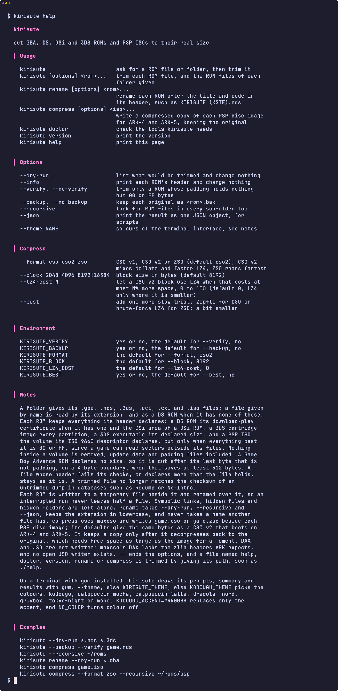<br><sub>說明頁</sub></td>
</tr>
</table>

</details>

<a id="development"></a>

## 開發

| 指令 | 說明 |
|:-----|:-----|
| `make fmt` | 以 shfmt 格式化所有腳本 |
| `make lint` | shfmt、對所有腳本、測試和自動完成執行 ShellCheck、名稱檢查，以及對 man 說明頁執行 mandoc |
| `make test` | 在系統 `sh` 下執行 `bats` 測試 |
| `make test-all` | 在每種 shell 下執行同樣的測試，macOS 上包括 bash 和 zsh 的兩個版本 |
| `make test-linux` | 在 Ubuntu 容器內執行同樣的測試 |
| `make coverage` | 合併本機與 Ubuntu 容器內的 bashcov 行覆蓋率，並執行與 CI 相同的 100% 門檻 |
| `make screens` | 在 macOS 上用 VHS 從真實工具錄製 README 的畫面 |

測試剪裁的是真實檔案。每個系統都有一個產生器，寫出標頭和校驗和都正確的檔案：DS 用 [`test/rom.bash`](test/rom.bash)，另有 [`test/gba.bash`](test/gba.bash)、3DS 用 [`test/ctr.bash`](test/ctr.bash) 和 [`test/psp.bash`](test/psp.bash)。標誌圖像以替代資料代替，所以儲存庫中沒有任天堂或索尼的資料。只有失敗是注入的，經 `PATH` 上的小型包裝腳本進行。推送到 `main` 而 CI 通過後，semantic-release 便會執行：`feat` 或 `fix` 提交會發佈新版本，更新 [`lib/core.sh`](lib/core.sh) 中的 `KIRISUTE_VERSION` 和 CHANGELOG，並更新 Homebrew formula。

## 授權

[MIT](LICENSE)
